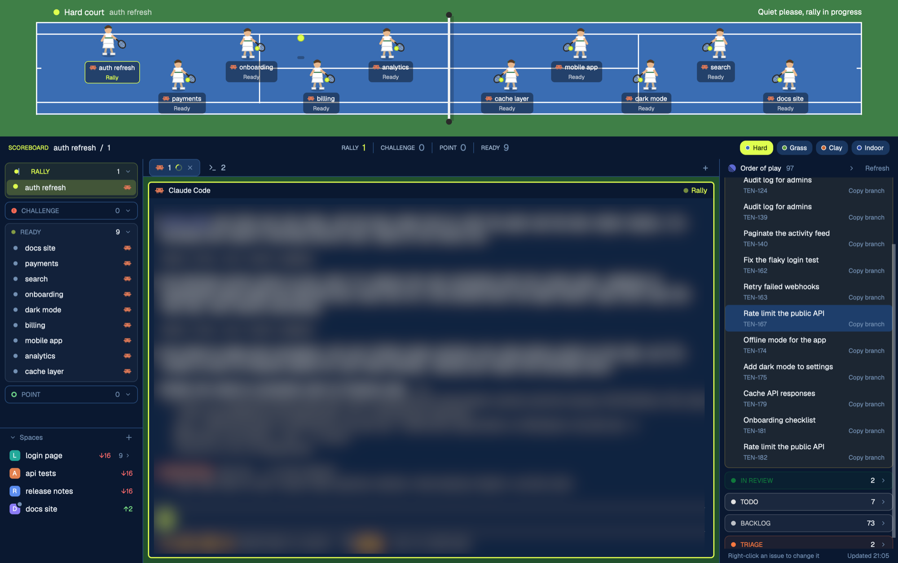

# Tennis + Linear

The Tennis layout with your Linear issues beside it. Every agent is a player on a top-down court; agents at work rally a ball over the net, agents that need you jump and call a challenge, and finished ones show "POINT". A scoreboard counts each status and switches between four courts: hard, grass, clay and indoor. On the right, "Order of play" lists the Linear issues assigned to you, grouped by status, shows which ones an agent is playing, and lets you change them or serve one to a new agent in a fresh worktree.

## What you see

Top to bottom:

1. **Court**, 230px tall (drag between 140 and 420px). A surround (`#3f7f47` on hard) with a court inside it, inset `max(60px, 4%)` from the left and `max(34px, 16%)` top and bottom, ending 40px before the bench when the bench shows; otherwise the court is centered with the same margin on both sides. White 2px lines: doubles box, singles sidelines 12.5% of the court height in from each side, service lines 23% of the court width either side of the net, the center service line and baseline center marks. The net is a vertical 4px `#f2f2f2` bar with a 6px `#00000030` shadow to its right and 10px `#2a2a2a` posts above and below. Top left, at least 90px in to clear the window buttons: a 10px ball-yellow dot, the court name (14px, 800) and the active space's name (13px, `#ffffffb0`). Above the court's right end: the umpire's call (13px, 700).
   **Bench**, on the right, only when there are more than 10 agents: `clamp(15% of the width, 170px, 240px)` wide, 24px from the window edge, on a `#00000026` panel with 10px corners. Header "BENCH" (12px, 800) and how many sit there. Up to three wooden benches stacked 78px apart, as many as fit the height: a 7px `#7a5130` backrest, a 7px `#b07a45` seat and 4px `#7a5130` legs. Each seat is 48px wide and holds a 40 x 52px seated player in whites with a green towel, an 8px status dot at its top right and its space name under it (9px, 600, white, truncated).
2. **Scoreboard**, 38px, `chrome` background. Left: "SCOREBOARD" (10px, 800, `accent`) and `space / tab` (13px, 600). Center: four cells, RALLY, CHALLENGE, POINT and READY, each a 10px label in `muted` and a 15px count in the status color (`dim` when 0), split by 1px x 18px `border` dividers. Right: four court chips (Hard, Grass, Clay, Indoor), each an 8px swatch of that court plus its name; the shown court's chip is `accent` with `accent_foreground` text.
3. **Work area**, three columns: a 240px left column, with an agents panel on top and Herdr's Spaces list below it (half the height each; drag the 1px divider between them, and the app remembers where). Clicking the "Spaces" header (now with a fold chevron) shrinks the Spaces list to its 31px header and shows the number of spaces; clicking again restores it. Each repo row with worktrees under it gets a small chevron after its git details that hides those worktrees, showing how many while folded. Both folds are remembered (`localStorage` keys `tennis.spaces.folded` and `tennis.worktrees.folded`). Each space with an agent shows one status marker for its most urgent agent (blocked, then done, working, idle): Challenge, an 8px `blocked` dot pulsing (opacity 0.35 to 1, 700ms); Point, an 8px `done` ring; Rally, an 8px ball-yellow ball bouncing 4px (560ms); Ready, a 7px `idle` dot. On a worktree row the marker takes the branch icon's place; on a top-level space it sits in a 12px `chrome` circle on the top-right corner of the letter badge, so the name keeps its full width. Spaces without agents keep their branch icon. The column sits a middle column with a 30px tab bar (the shipped `tabs` mod) over the active tab, and the Linear panel on the right (300px, below). The agents panel shows your agents in four separate sections, in this order: **Rally** (working), **Challenge** (blocked), **Ready** (idle and unknown) and **Point** (done). Each section is a card 8px in from the panel edges, 6px apart, with 8px corners, a background of its status color at 8% (`14` alpha) and a border at 25% (`40` alpha); an empty section is plain `chrome` with a `border` border. Its 28px header shows a marker, the section name (11px, 800, uppercase, in the status color, `dim` when empty), the count and a fold chevron. Markers: Rally, a 7px ball-yellow ball crossing a 2px net (`left` 0 to 18px, 1200ms); Challenge, a 9px `blocked` circle with a 6.5px "!", pulsing (opacity 0.45 to 1, 700ms) only while an agent waits for you and still otherwise; Ready, a ball-yellow ball at 55% opacity; Point, a 2px `done` ring. Under the header, one 26px row per agent: its own marker (Rally, an 8px ball bouncing 4px, period 520 to 700ms, staggered; Challenge, an 8px `blocked` dot pulsing; Ready, a 7px `idle` dot; Point, an 8px `done` ring), its space name over the full row width (12.5px, truncated only at the edge) and its program icon (13px) on the right. The focused agent's row is its status color at 20%. Clicking a header folds that section, remembered across restarts (`localStorage` key `tennis.groups.folded`). The panel scrolls when the sections are taller than it. Panes are cards: 8px gap, 6px radius, 2px `border` border, 2px `accent` when focused, framed even when alone. Each pane has a 26px header: program icon (15px), program name (600), `on <branch>` in `dim`, and on the right a status dot and word.

4. **Linear panel** ("Order of play"), 300px, `chrome` background, folding to a 36px strip.
   - Header, 31px: the Linear logo (13px, `#5e6ad2`), "Order of play" (700), the issue count, a fold chevron and "Refresh".
   - Body: the issues assigned to you that aren't completed, canceled or duplicates, grouped by Linear workflow state (started, then unstarted, backlog, triage; Linear's own order inside each type and inside each state). Each state is a card like the agents panel's: 8% tint and 25% border of the state's Linear color, a 28px header with a dot, the uppercase name, the count and a fold chevron.
   - Each issue is two lines: the title (12.5px, truncated), then the ID (10.5px, `dim`), the agent status word if one is on it, and "Copy branch" at the right end. A 14px slot left of the title holds the agent's marker (the same markers as the agents panel).
   - Footer, 24px: "Right-click an issue to change it" and "Updated HH:MM" (or "Refresh failed, last HH:MM").
   - Folded strip: the Linear logo, a left chevron, the total, and a dot with the count for each state; a red dot when the key is missing or Linear can't be reached.
   - Right-click menu, a 340 x 700px popup at the pointer, scrolling when long: the ID and title; a **SERVE** box (ball-yellow tint) with the issue's Linear branch name, a "New Claude Code tab in <space>" button when a space is already on that branch, and one equal-width button per repo from `serve.json` under "New worktree from main in:"; **STATUS** (the team's workflow states, current one marked); **PRIORITY** chips (Urgent, High, Medium, Low, None); **TITLE** and **COMMENT** inputs with Save and Post; **PARENT** and **SUB-ISSUES (n)** (state color, ID, title, assignee's first name); "Open in Linear".

Courts (layout surface colors, then theme `background` / `accent`):

| Court | Court | Stripe | Surround | Lines | Theme background | Accent |
|---|---|---|---|---|---|---|
| Hard | `#3a6db3` | none | `#3f7f47` | `#ffffff` | `#0f2340` | `#dfff4f` |
| Grass | `#5c9a3c` | `#69a847` | `#4a7f30` | `#fbfbf3` | `#10241a` | `#c39bf0` |
| Clay | `#c8632f` | none | `#a8512a` | `#fff7ee` | `#2a140c` | `#4fbf7f` |
| Indoor | `#2346a8` | none | `#141826` | `#ffffff` | `#0f1018` | `#4fd1ff` |

Grass is mown: 12 vertical bands alternating court and stripe colors.

Players are 46 x 57px figures in tennis whites holding a racket, facing the net. Under each: a dark `#00000066` label up to 180px wide, centered on the player, with two lines: the program icon (12px) and the agent's space name (11px, 600, white), then its status word under the name (9.5px, 700) in the status color, or `#ffffffb0` for Ready and Warm-up so it stays readable on the court. The focused agent's pill has a 1px ball-yellow border.

## How it behaves

- Agents alternate sides: first left, second right, and so on. Blocked agents get places first, then working, done, idle and unknown, so busy agents are never hidden. Players stand 132px apart from the baseline toward the net, zigzagging 17% of the court height above and below the center line; the right side's zigzag is mirrored, so the two players nearest the net stand at different heights. The last one stays far enough from the net that its 180px label doesn't cross it (half the label beyond the figure, plus 8px). With 10 agents or fewer, the spacing shrinks (down to 66px) until everyone is on court. With more than 10, the rest sit on the bench in the same order, filling each bench left to right; their dot pulses (opacity 0.4 to 1, 800ms) while working or blocked. When the benches are full, "+N more" shows at the bench area's bottom right. Clicking a seated player focuses that agent.
- **working (Rally):** the player bounces 5px (560ms). While any agent works, a 12px ball (`#dfff4f`, `#a8c225` edge) rallies between the first working player on each side, racket to racket, in 1800ms, arcing 28px up mid-flight, with a 12 x 5px `#00000044` shadow on the ground. With working players on one side only, the ball goes to the opposite baseline center and back. Umpire: "Quiet please, rally in progress".
- **blocked (Challenge):** the player jumps 16px (760ms) under a "CHALLENGE" badge in the `blocked` color that pulses (opacity 0.6 to 1, 700ms). The umpire call reads "Challenge! N agent(s) need you" in `blocked` and pulses too.
- **done (Point):** a "POINT" badge in the `done` color. Umpire: "Point! Check the results".
- **idle (Ready) / unknown (Warm-up):** an 8px ball bounces at the player's feet (900ms). Umpire: "Players ready".
- No agents: "No players on court yet. Start an agent to serve." across the court.
- Clicking a player runs `agent.focus` for it. The court strip drags the window.
- Clicking a court chip runs `app.theme` with that court's theme; the court drawing, scoreboard, both side panels and terminals all switch together. Picking a tennis theme in Settings does the same.
- A pane header's working dot is ball-yellow and pulses (opacity 0.35 to 1, 800ms).
- Players slide to new spots (`top` transition, 500ms) when the line-up changes.

- Linear panel: refreshes every minute and within a second of any change made from the menu. Clicking an issue opens it in the browser (`open <url>`). Clicking an agent marker focuses that agent. "Copy branch" copies the issue's Linear branch name (`pbcopy`) and posts "Branch copied". Clicking a state header folds it; clicking the header chevron folds the whole panel to the strip and clicking the strip opens it (`layout.resize` on column `tennis-linear`, 36 or 300px). Both folds are remembered (`localStorage` keys `linear.folded` and `linear.collapsed`).
- An issue is "played" when any terminal in a space has a git branch containing the issue ID as a whole token (`abc-123` matches `me/abc-123-fix-login`, not `abc-1234`); its marker and word are the most urgent status of the agents in those spaces.
- Menu changes go straight to Linear (`issueUpdate` for status, priority and title; `commentCreate` for comments), then post a success notification ("ABC-123 moved to In Review") and close; on failure the menu stays open with Linear's message. Nothing deletes or archives an issue.
- **Serve**: fetches the issue's description, then either opens a new tab running the agent in the space already on the branch, or, for a repo button: `git fetch origin <base>`, reuses an existing worktree on the branch if there is one, otherwise `git worktree add` at `~/.herdr/worktrees/<repo>/<branch with anything outside A-Za-z0-9._- turned into ->` on the existing local branch or a new `--no-track` branch from `origin/<base>`, then `space.new` there (unnamed, so it nests under its repo) with the agent and a first message of the issue's ID, title, link and description.

## Built from

- `layouts/Tennis-Linear.json`: a root column with `titlebar: "none"`, `traffic_lights: [16, 18]`, `theme: "tennis-hard"`, `font_size: 13`, `ui_font: "Geist"`, `background: "canvas"`, `terminal_padding: [8, 10]` and `preview: "layouts/Tennis-Linear.svg"`. Children: `tennis-court` (block, mod `tennis`, `window_drag`), `tennis-scoreboard` (block, mod `tennis` with props `{ "role": "scoreboard" }`), then a row of two columns: `sidebar` (240px, min 40, max 420px, with a 1px `border` divider) holding `tennis-agent-groups` (mod `tennis-spaces` with props `{ "role": "agents" }`) over `tennis-spaces` (mod `tennis-spaces`, no props), each weight 1, min 120px for the agents and 31px for the Spaces so it can fold to its header; `tennis-work` (shipped `tabs` mod, then the `{ "tab": "active" }` block with the pane frame above and a header of mod `tennis` with props `{ "role": "pane" }`); and `tennis-linear` (300px, min 36, max 520px, holding mod `linear-court`). The left column keeps the id `sidebar`, so `ctrl-shift-b` and the spaces mod's narrow rail still work on it.
- `mods/tennis/main.js`: one `View` with three roles. No role draws the court; `scoreboard` draws the bar; `pane` draws a pane header. It uses `agents()`, `spaces()`, `panes()`, `props()`, `settings()`, `theme()`, `setAgentOrder()` and `run()` with `agent.focus` and `app.theme`. It runs no programs, makes no network calls and reads no files.
- `mods/tennis-spaces/`: made with `herdr-app do mod.clone --name spaces --as tennis-spaces` (spaces 0.1.12), then changed as follows. With props `role: "agents"`, `render()` draws only `agentGroups()`, which splits `agents()` into the four sections from a `GROUPS` table (key, label, statuses, theme color), with `groupMark()` and `agentMark()` drawing the markers; rows run `agent.focus` on click. Without that prop it draws Herdr's spaces list with these additions: `toggleSpaces()` runs `layout.resize` on block `tennis-spaces` (`px: 31` to fold, `weight: 1` to unfold), `worktreeFold()` draws the per-repo chevron, `render()` picks each space's most urgent agent status from `agents()` and `statusMark()` draws its marker, with `ordered()` skipping a folded repo's worktree rows and recording each repo row's `kids` count. The rest is unchanged: worktree nesting, git branch and ahead/behind, drag to reorder, right-click menu and machines are all Herdr's.
- `mods/linear-court/`: one `View` with two roles. No role is the panel; props `role: "menu"` is the right-click popup, opened with `openOverlay({ mod: "linear-court", kind: "popup", props: { role, issue, states } })`. It calls Linear's GraphQL API (`https://api.linear.app/graphql`) with a personal API key read from the macOS Keychain (`security find-generic-password -s herdr-linear -w`), never from a file. The panel query asks for `viewer.assignedIssues` (id, identifier, title, url, priority, branchName, team, state) filtered to state types other than completed, canceled and duplicate, plus every team's workflow states. The menu loads the issue's parent and sub-issues, and Serve its description, when needed. It uses `agents()`, `spaces()`, `panes()`, `exec` (`security`, `git`, `open`, `pbcopy`), `fetch`, `readTextFile`, `openOverlay`, `closeOverlay`, `notify`, `shared`/`setShared` (key `linear.changed`, which the panel checks every second) and `run` with `agent.focus`, `layout.resize`, `tab.new` and `space.new`. Art: `linear.svg`, the Linear mark from Simple Icons.
- `mods/linear-court/serve.json`: `{ "agent": ["claude"], "base": "main", "repos": [{ "name": "my-app", "path": "~/code/my-app" }] }`. `agent` is the command Serve starts, `base` the branch new worktrees start from, `repos` the buttons in the Serve box (`~/` is your home). It ships with no repos.
- The court is drawn from absolutely positioned `div`s sized from `on_size_change`, so it fills any window width.
- Art: `mods/tennis/player-facing-right.svg` (left-side players), `player-facing-left.svg` (right-side players, the same drawing mirrored) and `player-sitting.svg` (bench players, front view). The benches are `div`s.
- `themes/tennis-hard.json`, `tennis-grass.json`, `tennis-clay.json`, `tennis-indoor.json`: dark terminal themes in each court's colors. `working`, `blocked` (`#ff6b57`), `done` and `idle` are set per theme.

## Watch out

- `loop()` animates one property per element, so the rallying ball is three nested `div`s: an outer one looping `top` between the two rackets, a child looping `left`, and the ball itself looping `top` for the arc at half the period. All three use `linear` easing except the arc (`ease-out`); keep the periods equal or the ball leaves its path.
- `on_size_change` reports the block's size before the person's zoom, but `left`, `w` and the other sizes are scaled by it. Divide the reported size by `settings().zoom`, or at zoom 0.9 the court comes out 10% narrow with a gap on the right.
- The court reads which court to draw from `settings().theme`. Any theme that isn't one of the four tennis themes draws the hard court.
- The court block has `window_drag`, so each player stops the left mouse-down from propagating, otherwise clicks drag the window.
- Tab names are often just numbers, so player labels use the space name.
- Red pulses only while an agent is blocked. A marker that pulses with nothing waiting reads as a false alarm.
- Never put a status beside a name: in the agents panel, on a space's row or on a court label it squeezes and cuts the name. Statuses go in their own section (agents panel) or on the line under the name (court), and the agents panel shows the program as an icon, not text.
- When the spacing shrinks for 10 agents, the court can't hold more than 5 a side at narrow widths; anyone left over shows as a "+N waiting" pill in the court's bottom right.
- The worktree chevron stops the left mouse-down from propagating; otherwise the press starts the row's drag-to-reorder and selects the space.
- Dragging the divider by hand doesn't update the Spaces chevron; the fold state is the mod's own, set only by clicking the header.
- `tennis-spaces` is a copy of Apache-2.0 Herdr code: keep the notice at the top of `tennis-spaces/main.js` that says where it came from and that it was changed.
- The court shows agents from every space, not only the active one.
- Theme picks are stored per layout in `layouts/.state/`, so a court chosen here stays on this layout only.

- The Linear panel is macOS only: the key comes from the Keychain, links open with `open` and branches are copied with `pbcopy`.
- Add the key with `security add-generic-password -s herdr-linear -a linear -w` (add `-U` to replace one). It needs write access for the menu's changes; a read-only key still shows the list.
- Linear refuses queries that are too expensive. Keep the refreshing query lean and load parent, sub-issues and descriptions only when the menu needs them.
- Write `mod.json` (`{"place":"none"}`) before `main.js` when creating a mod folder: a folder seen without it is docked into the shown layout.
- Layout names come from file names, and `layout.switch` can't reach a name with spaces or "+": that's why the file is `Tennis-Linear.json`, not "Tennis + Linear".
- New worktree branches use `--no-track`; tracking `origin/main` would let a plain `git push` aim at main.
- Branch matching uses each terminal's live branch from `panes()`, with `spaces()[].branch` as a fallback; the space's own branch is often empty.

## Done when

- `herdr-app check mods/tennis` passes and `herdr-app status` shows no errors with the layout shown.
- With two agents working, they stand on opposite baselines labelled "Rally" and a ball flies between their rackets with its shadow on the court.
- An agent waiting for approval jumps under a pulsing "CHALLENGE" badge and the umpire call turns red.
- Clicking Grass, Clay and Indoor on the scoreboard recolors the court, the scoreboard, both side panels and the terminals; Grass shows mown stripes.
- Clicking a player focuses that agent's terminal.
- The agents panel on the left shows Rally, Challenge, Ready and Point as separate cards in that order, the Spaces list is below them, each agent in exactly one of them with its full space name, and clicking a header folds that section.
- Court labels show the whole space name with the status on the line below it.
- With 10 agents, all 10 stand on court with no bench and no labels crossing the net; with 11 or more, the bench appears on the right and the extra agents sit on it.
- At zoom 0.9 the court (and the bench, when shown) reaches the window's right side with no empty gap.
- With a Linear key in the Keychain, "Order of play" lists your open assigned issues grouped by state, with the Linear logo in its header; without one it shows the Keychain command.
- An issue whose ID is in an agent's branch shows that agent's marker and status word.
- Right-click, then a status, moves the issue in Linear and into its new card within a few seconds; Copy branch puts the branch name on the clipboard.
- Serve with a repo in `serve.json` creates `~/.herdr/worktrees/<repo>/<branch>` from `origin/main`, nests the new space under the repo and starts the agent with the issue as its first message.
- The header chevron folds the panel to a 36px strip with counts per state, and clicking the strip opens it again.
